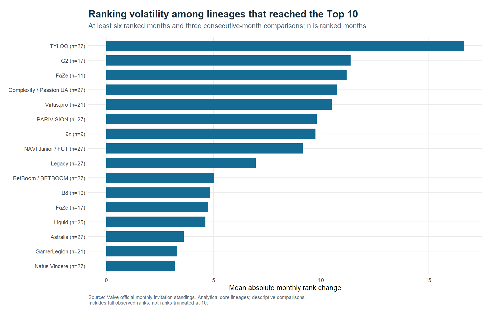

# Exploratory findings

Official monthly invitation standings: **2024-08-06 to 2026-10-05**. This is an exploratory research note, not a finished course report.

## What was actually collected

The archive contains 23,999 distinct source path/blob versions. The canonical global dataset contains 14,070 roster-snapshot observations across 56 dates; the primary monthly panel contains 7,827 observations across 27 months.

The earliest regional snapshot recovered is 2024-03-04. The global panel begins on 2024-04-22. No January or February 2024 ranking observation has been invented. Raw files and historical revisions are preserved locally; the public repository contains provenance and retrieval scripts.

## 1. How persistent is the Top 10?

Across 22 evaluable consecutive-month transitions, the mean Top 10 core-lineage retention rate is **85.9%**. The exact-roster retention rate is **76.8%**. Core continuity tolerates one- or two-player changes under the documented mutual-match rule; the exact-roster comparison requires an unchanged displayed player set.

Excluding transitions across the project's broad model-period boundaries, mean core retention is **85.3%**. This is a sensitivity comparison, not a claim that all remaining observations are perfectly comparable.

Both headline rates use the same evaluable transitions. 4 of 26 transitions have unresolved core identity and are excluded. Across all transitions with complete displayed rosters, exact-roster retention is 75.0%. Missing core estimates are not zero retention.

The gap between the two measures shows why roster identity changes the interpretation of 'stability'. A change in a displayed lineup does not necessarily mean a new organisation or a departure from the elite tier. Labels such as HEROIC / Falcons refer to a linked player core across organisations, not one club's uninterrupted history.

| Lineage labels | Top 10 months | Longest run | Ranked months |
| --- | --- | --- | --- |
| Vitality | 27 | 27 | 27 |
| Spirit | 27 | 27 | 27 |
| MOUZ | 26 | 21 | 27 |
| HEROIC / Falcons | 24 | 24 | 27 |
| Natus Vincere | 24 | 15 | 27 |

## 2. Ranking mobility and selected cases

Volatility uses the full published rank, not a Top-10-censored rank. Eligibility requires six ranked months and at least three adjacent-month comparisons. The denominator and observation count accompany every summary. A missing ranking is not assigned zero or a synthetic last place.

| Selection | Team | Start rank | End rank | Three-month improvement |
| --- | --- | --- | --- | --- |
| Largest three-month rise | Betera | 285 |  80 | 205 |
| Largest three-month decline | ECSTATIC | 105 | 350 | -245 |
| Most stable eligible elite lineage | Vitality | n/a |   3 | n/a |

The rise and decline cases are selected by three-calendar-month rank changes among eligible lineages. The stable case is selected from lineages that reached the Top 10. Different starting ranks and unequal coverage limit direct comparisons; these are illustrations, not population-wide causal findings.

## 3. Regional representation and components

Regional Top 20 charts start in July 2025, after the change to one regional assignment. Earlier multi-region eligibility remains in the underlying tables, but is not summed into an apparently mutually exclusive regional composition.

Component distributions are restricted to the latest model period. Bounty, network and LAN components are inputs to the ranking formula itself. Their association with rank is a description of the model's construction, not independent evidence that increasing one component causes a particular ranking improvement.

## Latest published Top 10

Snapshot: 2026-10-05. Points are displayed for this date only.

| Rank | Team | Points | Roster |
| --- | --- | --- | --- |
|  1 | Spirit | 2046 | donk, magixx, sh1ro, tN1R, zont1x |
|  2 | Legacy | 1931 | arT, dumau, latto, n1ssim, try |
|  3 | Vitality | 1911 | apEX, flameZ, mezii, ropz, ZywOo |
|  4 | MOUZ | 1863 | PR, Spinx, torzsi, xelex, xertioN |
|  5 | G2 | 1847 | HeavyGod, huNter-, MATYS, NertZ, r1nkle |
|  6 | Falcons | 1843 | karrigan, kyousuke, m0NESY, NiKo, TeSeS |
|  7 | FURIA | 1829 | FalleN, KSCERATO, molodoy, YEKINDAR, yuurih |
|  8 | FUT | 1799 | cmtry, dem0n, dziugss, Krabeni, xfl0ud |
|  9 | Aurora | 1716 | Jimpphat, kyxsan, Wicadia, woxic, XANTARES |
| 10 | Astralis | 1674 | HooXi, jabbi, phzy, ryu, Staehr |

## What these data cannot establish

- The causal effect of a transfer, coaching decision, organisational budget or tournament access.
- A complete independent match-results archive: detail rows repeat across snapshots, and Match ID is local to each calculation.
- A common absolute skill scale for raw points across model changes.
- True transfer dates: roster-change markers indicate the first observed published change.
- Exact replication of Valve's full ranking computation without its complete underlying input data.

## Best short-report route

Use Top 10 persistence as the central question, ranking mobility as the supporting comparison, and one or two automatically selected trajectories as illustrations. Keep regional composition or component analysis as a substitute extension rather than adding every topic to a 1,000-word report.

These preliminary interpretations were generated with coding-assistant support. The student should check the evidence and rewrite the final course interpretation in their own words. Numerical results are reproduced by R/08_write_findings.R.
