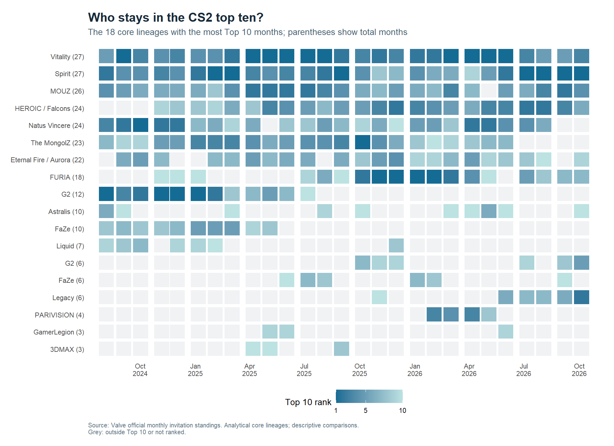

# 探索性解读

主分析区间：2024-08-06 to 2026-10-05，采用官方月度 invitation 全球榜。本文件是初步研究笔记，不是完整课程报告。

已归档 23,999 个不同源路径／内容版本。全球主表含 14,070 行、56 个日期；月度面板含 7,827 行、27 个月。

## 最值得写的发现

相邻月份的 Top 10 核心阵容平均保留率为 **85.9%**；如果必须保持完全相同的公布名单，保留率为 **76.8%**。二者衡量不同层次的稳定性：一两名选手改变后，队伍仍可能延续在精英层。

排除本项目划分的方法时期断点后，核心阵容平均保留率为 **85.3%**。这个比较用来检查结论对规则变化是否敏感，不代表其余时期完全没有口径问题。

| Lineage labels | Top 10 months | Longest run | Ranked months |
| --- | --- | --- | --- |
| Vitality | 27 | 27 | 27 |
| Spirit | 27 | 27 | 27 |
| MOUZ | 26 | 21 | 27 |
| HEROIC / Falcons | 24 | 24 | 27 |
| Natus Vincere | 24 | 15 | 27 |

上述两个保留率使用相同的 22 组可判断比较；另有 4 组因核心身份存在歧义而排除。所有完整名单比较的严格名单保留率为 75.0%。HEROIC / Falcons 等合并标签表示选手核心的延续，不等同于俱乐部历史。

## 如何读波动和轨迹

波动使用全部实际名次，不把第十名以外的排名截断。至少上榜六个月、具有三组相邻月份比较的阵容才进入波动排序；每个结果同时给出观测月份数。未上榜不能当作零分、最后一名或解散。

| Selection | Team | Start rank | End rank | Three-month improvement |
| --- | --- | --- | --- | --- |
| Largest three-month rise | Betera | 285 |  80 | 205 |
| Largest three-month decline | ECSTATIC | 105 | 350 | -245 |
| Most stable eligible elite lineage | Vitality | n/a |   3 | n/a |

上升与下降案例按三个月名次变化自动筛选；稳定案例从曾进入 Top 10 的阵容中选择。这些案例用于说明总体格局，不用于证明换人、管理或训练产生了因果效果。橙色阵容变化标记只是首次在榜单中观察到变化的时间。

地区构成图从 2025 年 7 月开始，避免把此前可同时归属多个地区的队伍重复算入互斥比例。分项图只比较最新模型时期；分项本来就参与积分公式，相关性不能被写成独立的成功原因。

## 适合课程短报告的组织方式

1. 用 Top 10 稳定性提出核心问题。
2. 用名次波动解释不同阵容的差异。
3. 用一至两个可复现筛选的上升、下降或稳定案例帮助读者理解。

不要把全部六个分析方向塞进约 1000 词报告。地区或分项分析可以替换其中一个补充角度。

## 必须保留的限制

2024 年 1–2 月缺少新的官方快照；最早全球榜为 4 月 22 日。原始积分不能跨模型版本直接当作同一绝对能力尺度。Match ID 不是跨快照永久编号，同场比赛的贡献会重复出现。2025 年 8 月后不足五人的公布名单不能自动解释成转会。

这些解读由真实数据与脚本生成，属于辅助研究笔记；后续课程写作应由你核对证据并形成自己的表述。
